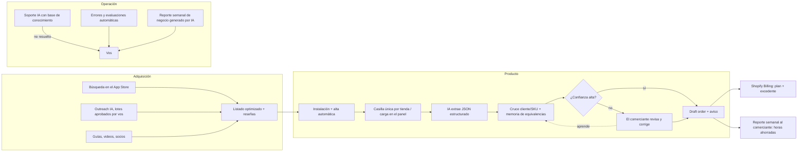

# 03 — El negocio elegido, en 27 respuestas

> **Negocio:** app de Shopify que convierte órdenes de compra B2B (PDF, email, Excel o foto) en *draft orders*.
> La IA extrae los datos y cruza cada línea con los SKUs del catálogo; el comerciante revisa y aprueba.
> Nombre comercial a definir (verificar marcas y nombres existentes en el App Store antes de elegirlo).
> Convención: **Hecho** tiene fuente en `01-investigacion.md`; **Estimación** es un número propio; **Supuesto** no tiene evidencia directa todavía.

---

## 1. Qué negocio es

Un SaaS de nicho que se vende **solo** a través del Shopify App Store. Es de back-office: no toca el diseño de la tienda.
Funciona así:

1. El comerciante recibe un pedido mayorista (PDF adjunto, texto del email, Excel o foto) y lo reenvía a una casilla propia
   de su tienda, o lo sube desde el panel de Shopify.
2. La IA extrae comprador, número de orden, líneas (producto, variante, cantidad, precio), dirección y fechas.
3. El sistema identifica al cliente (empresa B2B de Shopify) y cruza cada línea con un SKU del catálogo.
   Usa una **memoria de equivalencias por comprador**: por ejemplo, "el código ABC-12 de la tienda X = nuestro SKU 4471-M".
4. Arma un *draft order* y marca en amarillo lo dudoso. El comerciante aprueba con un clic.
5. Cada corrección del comerciante entrena la memoria de equivalencias. Con el tiempo hay menos correcciones y más costo de cambiarse a otra app.

## 2. Qué problema resuelve

- **Carga manual de pedidos mayoristas.** Hecho, pero es un dato del propio vendedor: LevelOps dice que cada orden lleva
  5–10 minutos de tipeo.
- **Errores:** SKU equivocado, cantidades o precios desactualizados. Un error en un pedido mayorista cuesta caro: devolución,
  flete, relación con el cliente.
- **Demora:** la orden queda en la bandeja de entrada hasta que alguien la carga.
- **Por qué ahora (hecho):** desde abril de 2026 las funciones B2B de Shopify están disponibles en todos los planes pagos.
  Muchos comerciantes chicos y medianos empiezan a vender mayorista *dentro* de Shopify, pero sus compradores (tiendas, cadenas,
  distribuidores) siguen mandando órdenes desde sus propios sistemas.
  **Supuesto a validar:** una parte relevante de esos compradores no va a usar el portal B2B y va a seguir mandando PDF o email.

## 3. Quién paga

Marcas y mayoristas en Shopify con un canal de venta mayorista activo que reciben **al menos 15–20 órdenes por mes** fuera del portal.
Por ejemplo: alimentos y bebidas, cosmética, suplementos, juguetes, indumentaria, regalería, insumos industriales. Varios de estos
verticales aparecen en las páginas de LevelOps.

Decide la compra el dueño o el responsable de operaciones. Mercado inicial: **EE.UU.** (por idioma, poder de compra y reglas de
email B2B más permisivas). Después Reino Unido y Australia. España y LatAm entran como diferencial de idioma más adelante.

## 4. Por qué pagarían

Ahorro de tiempo medible. **Estimación:** a 7 minutos por orden y USD 25/hora de costo de operaciones en EE.UU.:

| Órdenes por mes | Horas ahorradas | Valor ahorrado | Precio de la app | Relación valor/precio |
|---|---|---|---|---|
| 30 | 3,5 h | ≈ USD 88 | USD 39 | 2,2× |
| 100 | 11,7 h | ≈ USD 290 | USD 99 | 2,9× |
| 400 | 47 h | ≈ USD 1.170 | USD 249 | 4,7× |

A esto se suma lo que es más difícil de cuantificar: menos errores y pedidos procesados en minutos en lugar de días.
Si el ahorro no supera 2× el precio, la app se desinstala. Por eso el cliente objetivo tiene **30 o más órdenes por mes**.

## 5. Cómo gana dinero

Suscripción mensual cobrada por **Shopify Billing**, más un cargo por uso cuando se supera el cupo de órdenes del plan.
Shopify cobra al comerciante y te paga en USD. Hecho: 0 % de comisión hasta USD 1M de ingresos de por vida.

## 6. Cuánto cobrar

| Plan | Precio | Órdenes/mes incluidas | Excedente | Precio efectivo por orden | Referencia LevelOps |
|---|---|---|---|---|---|
| Prueba | 14 días gratis | hasta 10 | — | — | tiene plan gratis |
| Starter | USD 39 | 30 | USD 1,00 | USD 1,30 | USD 50 por 15 (USD 3,33) |
| Growth | USD 99 | 120 | USD 0,75 | USD 0,83 | USD 250 por 100 (USD 2,50) |
| Scale | USD 249 | 500 | USD 0,50 | USD 0,50 | USD 750 por 500 (USD 1,50) |

**Lógica del precio:**

- Entrar un 60–67 % más barato por orden que el incumbente.
- Mantener el ingreso promedio por cliente (ARPU) cerca de **USD 70–80** (**estimación**, con más clientes en Starter y Growth).
  No bajar de USD 39: según ChartMogul, los productos de IA de menos de USD 50/mes retienen apenas el 23 % de sus ingresos al año.
- **Subir precios** cuando haya más de 30 reseñas.

## 7. Costos aproximados (**estimación**, USD por mes)

| Rubro | Validación y MVP (meses 1–2) | A USD 1.000 MRR | A USD 5.000 MRR |
|---|---|---|---|
| Registro en Shopify Partners (pago único) | 19 | — | — |
| Asistente de programación con IA (suscripción) | 20–100 | 100 | 100–200 |
| API de IA (extracción) | 10–30 | 30–60 | 250–400 |
| Hosting y base de datos | 0–25 | 25–50 | 60–120 |
| Email entrante y transaccional | 0–15 | 15 | 20–40 |
| Dominio y casilla para outreach | 10 | 10 | 10 |
| Soporte, monitoreo, analytics | 0 (planes gratis) | 0–30 | 50–100 |
| Comisiones de cobro (PayPal o transferencia, 1–4 %) | — | 10–40 | 50–200 |
| Monotributo (según categoría; verificar tabla vigente de ARCA) | ≈ 33 (cat. A) | ≈ 43 (cat. C) | categoría alta: a verificar |
| Contador | a cotizar | a cotizar | a cotizar |
| **Total aproximado** | **≈ 100–250** | **≈ 250–400** | **≈ 700–1.200** |

## 8. Margen potencial

- **Margen bruto** (después de IA, infraestructura y cobro): **≈ 85–92 %**.
- **Margen neto operativo** después de herramientas e impuestos fijos: **≈ 75–85 %** a USD 5.000 MRR (**estimación**).
- Tu costo de vida en Argentina baja el punto de equilibrio: **USD 1.000–1.500 MRR ya es un ingreso relevante**.
  Una empresa en EE.UU. necesitaría 5 a 10 veces eso.

## 9. Qué competidores existen

| Competidor | Tipo | Fortaleza | Debilidad para nosotros explotar |
|---|---|---|---|
| **LevelOps PDF to Order** | App nativa de Shopify | 5,0★ (18 reseñas), integra ERPs (Cin7, Katana, Odoo, SAP B1), enfoque por vertical | Precio de entrada alto (USD 50 por 15 órdenes). Pocas reseñas → poca "prueba social" todavía. |
| **AutoApprove** | App o servicio | Mismo caso de uso | No pude verificar precio ni tracción. |
| **Asistentes de IA + conectores** (Claude o ChatGPT con MCP de Matrixify, etc.) | Hágalo usted mismo | Gratis o barato para quien sabe usarlos | Sin bandeja de entrada, sin memoria de equivalencias, sin pantalla de revisión, sin registro de cambios. Exigen un usuario técnico. |
| **Asistente virtual humano** (Upwork, etc.) | Servicio | Flexible | Costo por hora, errores, rotación, horario. |
| **OCR genérico + Zapier/Make** | Integración casera | Flexible | Frágil, hay que configurarlo, no entiende de SKUs ni variantes. |
| **Portal B2B de Shopify** (el comprador carga el pedido solo) | Nativo | Gratis, sin cargar nada | Solo funciona si el comprador acepta usarlo. Las cadenas y distribuidores suelen mandar su propia orden. |
| **Shopify Sidekick** (futuro) | Asistente nativo | Podría "crear un draft order desde este PDF" | **Riesgo principal de plataforma.** Mitigación en la sección 24. |
| **EDI** (SPS Commerce y similares) | Enterprise | Estándar de las grandes cadenas | Caro y complejo. Otro segmento. |

## 10. Qué ventaja podemos construir (siendo honestos: ninguna alcanza sola)

1. **Memoria de equivalencias por comprador.** Cuanto más se usa, menos correcciones hace falta. Es el principal costo de
   cambiarse a otra app y el mejor argumento contra la IA genérica.
2. **Base de evaluación propia.** Cientos de órdenes reales anonimizadas, con los datos correctos, para medir precisión y cambiar
   de modelo de IA sin romper nada.
3. **Precio de entrada bajo sostenible,** gracias a la estructura de costos en Argentina. Permite atender al mayorista chico que
   el incumbente deja afuera.
4. **Velocidad de reseñas en el lanzamiento.** Los clientes de la etapa manual de la Fase 1 son la base de las primeras reseñas
   honestas, y la velocidad de reseñas es el factor que más pesa en el ranking.
5. **Documentos difíciles:** fotos de pedidos escritos a mano, Excel desordenados, órdenes en español o portugués.
   Es un diferencial secundario que la IA hace barato.

## 11. Cómo conseguir los primeros clientes

Por orden de prioridad:

1. **Outreach dirigido y asistido por IA, 30–40 emails por día.** Se buscan marcas mayoristas que usan Shopify. Señales:
   - página "Wholesale" o "Become a stockist";
   - presencia en Faire;
   - listados de expositores de ferias mayoristas.

   La IA verifica que la tienda usa Shopify, encuentra el contacto de operaciones y redacta un mensaje corto. El mensaje hace una
   sola pregunta ("¿cuántas órdenes de compra por PDF o email cargás por semana?") y ofrece cargarlas gratis durante 2 semanas.
2. **Comunidades:** foros B2B de Shopify Community, r/shopify, grupos de marcas mayoristas. La regla: responder dudas reales
   sobre B2B. **Nada de spam.**
3. **Listado del App Store** optimizado para búsquedas como *purchase order*, *PO to order*, *wholesale order entry*,
   *draft order automation*, *email to order* y *B2B order automation*.
4. **Socios:** agencias y consultores de Shopify B2B, y apps complementarias (precios mayoristas, formularios B2B),
   con una comisión recurrente del 20 %.
5. **Contenido de apoyo:** guías y videos demo cortos ("cómo cargar órdenes de compra en Shopify B2B").
   YouTube y el propio App Store siguen trayendo búsquedas aunque Google dé menos clics.
6. **Anuncios en el App Store:** recién cuando haya 5 reseñas o más, con un presupuesto chico de prueba.

## 12. Cómo automatizarlo

Hay tres capas.

**A. El producto se automatiza a sí mismo.** Recibe el email → extrae → cruza con el catálogo → arma el draft order → avisa →
aprende de las correcciones. La revisión humana la hace **el comerciante**, no vos.

**B. La operación del negocio:**

- el alta y la puesta en marcha se hacen por emails automáticos, sin llamadas;
- Shopify se ocupa del cobro;
- los errores se agrupan solos y se abren como *issues*;
- la IA contesta el soporte desde la base de conocimiento;
- un script arma cada semana el reporte de métricas;
- después de cada cambio de prompt o de modelo se corre automáticamente la batería de evaluación.

**C. El crecimiento:**

- la IA arma y enriquece las listas de prospectos y redacta los mensajes (vos aprobás el lote semanal);
- propone variantes del listado;
- detecta clientes en riesgo cuando baja su uso;
- analiza las reseñas negativas de la competencia para priorizar funciones.

## 13. Qué herramientas de IA utilizaría

| Uso | Herramienta (ejemplos, intercambiables) |
|---|---|
| Programar la app | **Claude Code** (agente de programación) + Shopify CLI (plantilla oficial React Router), Polaris (UI), Prisma + Postgres |
| Extracción en el producto | **API de Claude** con salida estructurada y entrada de PDF nativa. Sonnet 5.5 u Opus 5.5 según la precisión medida en la batería de evaluación; Haiku 4.5 para clasificar documentos. Batch API (50 % menos) para reprocesos. |
| Email entrante | Postmark Inbound, Mailgun Routes o Cloudflare Email Workers |
| Soporte | Widget de chat o helpdesk con IA sobre tu base de conocimiento, o un agente propio con la API de Claude |
| Calidad | Batería de evaluación propia en GitHub Actions; Sentry (errores); PostHog (uso) |
| Investigación y prospección | Claude con búsqueda web / navegador (Claude in Chrome) para relevar el App Store y armar listas |
| Contenido y listado | Claude para textos, documentación y variantes; herramienta de grabación de pantalla para los videos demo |
| Reportes | Script programado (cron) que consulta la base de datos y los datos de Partners, y la IA redacta el resumen |

## 14. Qué tareas tendrías que hacer vos

- **Legales y fiscales:** cuenta de Partner, verificación de identidad, monotributo, factura E, contador, términos y política de
  privacidad (con borrador de la IA).
- **Decisiones:** elegir el nicho con la regla del plan, precios, qué funciones entran, cuándo pivotar o abandonar.
- **Las primeras 20–50 conversaciones con comerciantes.** No se pueden delegar: de ahí sale lo que la IA no puede inventar
  (cómo trabajan de verdad, qué los frena, cuánto pagarían).
- **Revisar y aprobar el código** que escribe la IA, sobre todo seguridad, permisos y todo lo que toca pedidos. **Salir a producción.**
- **Controlar la calidad:** revisar las fallas de la batería de evaluación y los casos que marca el sistema.
- **Soporte escalado:** errores graves, reintegros, clientes enojados.
- **Revisión del App Store:** responder los pedidos del equipo de Shopify.

## 15. Qué tareas haría la IA

| Función | Qué hace la IA | Nivel inicial → a 6 meses (**estimación**) |
|---|---|---|
| Investigación | Relevar competidores, minar reseñas y foros, investigar precios, verificar si una tienda usa Shopify | 70 % → 85 % |
| Creación del producto | Especificaciones a partir de las entrevistas, casos límite, diseño de la batería de evaluación | 50 % → 70 % |
| Programación | 70–90 % del código, tests, migraciones de versión de la API | 70 % → 85 % |
| Atención al cliente / soporte | Responder desde la base de conocimiento, clasificar, redactar respuestas | 40 % → 75–80 % |
| Marketing | Textos del listado, variantes, páginas comparativas, mensajes para socios | 70 % → 85 % |
| Contenido | Guías, documentación, guiones de videos, notas de versión | 80 % → 90 % |
| Prospección | Encontrar, verificar y enriquecer prospectos; personalizar mensajes | 60 % → 85 % |
| Ventas | Autoservicio desde el App Store; la IA redacta seguimientos | 30 % → 80 % (el App Store vende solo) |
| Email | Secuencias de alta, activación y recuperación de clientes | 80 % → 95 % |
| Facturación | Cobra Shopify; la IA prepara los datos de la factura E mensual | 90 % → 95 % |
| Análisis de datos | Reporte semanal, anomalías, grupos de clientes | 80 % → 90 % |
| Optimización | Propone experimentos (listado, precio, prompts) y analiza resultados | 50 % → 70 % |
| Detección de oportunidades | Agrupa pedidos de funciones y reseñas negativas de la competencia | 60 % → 80 % |
| Retención | Alertas cuando cae el uso, emails de reactivación | 60 % → 85 % |
| Reportes | Totalmente automáticos | 90 % → 95 % |

**Lo que la IA NO puede hacer de forma confiable (y por qué):**

- **Garantizar que un pedido está bien.** Puede leer un "8" como "3". Por eso el comerciante aprueba cada pedido y la batería de
  evaluación mide la precisión antes de cada cambio.
- **Asumir responsabilidad legal o fiscal**, firmar, verificar identidad.
- **Generar confianza con los primeros clientes.**
- **Decidir un cambio de rumbo** cuando los datos son ambiguos.
- **Responder a un incidente de seguridad** o a una caída con criterio.
- **Darse cuenta de cuándo las métricas mienten:** instalaciones de la competencia, cuentas de prueba, bots.

## 16. Qué tareas podrían automatizarse después

- **Aprobación automática** de pedidos de compradores de confianza, cuando todas las líneas tienen alta confianza y hay más de
  N pedidos sin correcciones. Es opcional y la activa el comerciante.
- Alta de clientes 100 % sin intervención: video + checklist dentro de la app.
- Soporte de primer nivel resuelto por la IA en el 80 % de los casos o más.
- Errores → *issue* → la IA propone el arreglo → vos aprobás. Humano solo en la aprobación.
- Outreach continuo con aprobación semanal por lotes.
- Experimentos de listado y precio con análisis automático.
- Segundo producto sobre el mismo motor "documento → acción en Shopify": por ejemplo, facturas de proveedores → recepción de
  mercadería y órdenes de compra nativas. Aprovecha el hueco que dejó el cierre de Stocky.

## 17. Cómo sería el sistema completo funcionando

**Tu semana en régimen estable** (**estimación**, a partir del mes 9–12 si hay tracción): unas 5–10 horas.

| Tarea | Horas por semana |
|---|---|
| Leer el reporte semanal y decidir | 1–2 |
| Casos de soporte escalados | 1–3 |
| Revisar y aprobar cambios de código de la IA | 1–2 |
| Revisar las evaluaciones de precisión | 1 |
| Estrategia: socios, precios, siguiente producto | 1–2 |

## 18. Tiempo estimado para el MVP (**estimación**)

- **Validación:** 10 días.
- **MVP publicable:** 3–4 semanas a tiempo completo si ya programás algo, o 5–8 semanas si arrancás de cero
  (hace falta aprender TypeScript básico, React, SQL, Git y la API de Shopify, con la IA como tutora).
- **Revisión del App Store:** variable; planificá 1–4 semanas (**supuesto**). Mientras tanto seguís con clientes "manuales" y armando la lista de espera.
- **Total hasta el primer cobro dentro de la app:** unos 6–10 semanas desde el día 1.
  **El primer cobro llega antes, en la Fase 1, con el servicio manual.**

## 19. Capital mínimo

- **Mínimo:** unos **USD 300–600** para los primeros 3 meses (tabla de la sección 7, sin anuncios).
- **Recomendado:** **USD 1.000–1.500**. Incluye colchón, una base de prospectos paga si hace falta y USD 200–300 para probar
  anuncios en el App Store después de las primeras reseñas.
- **No incluye tu costo de vida.** Si necesitás ingresos ya, este plan es compatible con un trabajo de medio tiempo,
  pero duplica los plazos.

## 20. Cómo conseguir los primeros USD 100

Antes de que exista la app:

1. Durante la validación (días 6–10) ofrecés **cargar gratis sus órdenes durante 2 semanas** a 3–5 mayoristas.
   Te reenvían los pedidos; tu script con IA los procesa; vos revisás y les devolvés un CSV o los cargás con acceso de colaborador.
2. Al terminar las 2 semanas: "¿Seguimos? USD 49/mes hasta que salga la app, y después precio de fundador en la app
   (Growth a USD 69 de por vida)". **Se cobra por PayPal como servicio.** No se puede cobrar la app fuera de Shopify
   Billing, pero sí un servicio manual.
3. Con 2 clientes que acepten → **≈ USD 100**.

Si ninguno acepta pagar después de ver el valor, **esa es la señal más barata que vas a conseguir de que el nicho no sirve.**

## 21. Cómo pasar de USD 100 a USD 1.000/mes (**estimación**: 14–15 clientes a unos USD 70)

- Lanzar la app y migrar a los clientes manuales, que dejan las primeras reseñas honestas.
- Outreach sostenido: unos 800–1.200 emails en 8–10 semanas.
  - Con un 5 % de respuesta salen 40–60 conversaciones.
  - Con un 30 % de prueba salen 12–18 instalaciones calificadas.
  - Con un 40–50 % de pago salen 5–9 clientes.
- A eso se suman las instalaciones orgánicas del App Store cuando haya 5–10 reseñas.
- Mejorar la activación: que el 50 % o más de las instalaciones procese su primera orden en menos de 48 horas.
- **Plazo esperable:** meses 3 a 6 desde el día 1, si la validación pasó.

## 22. Cómo pasar de USD 1.000 a USD 5.000/mes (**estimación**: 65–70 clientes)

- Conseguir el sello *Built for Shopify* (requisitos de rendimiento, calidad e instalaciones). Sin él es raro entrar en el top 10 de una búsqueda.
- Tener 30–60 reseñas con buena velocidad (pedir la reseña cuando el comerciante ve "X horas ahorradas", nunca comprarla).
- Integraciones que agregan valor y costo de cambio: exportar a ERPs e inventario, reglas de precio por cliente.
- Programa de socios con agencias B2B.
- Subir precios a los clientes nuevos al pasar las 30 reseñas.
- Churn por debajo del 4 % mensual. **A 4 % de churn, sostener 70 clientes exige unas 3 altas pagas por mes solo para no caer.**
- **Plazo esperable:** meses 9 a 18.

## 23. Qué tendría que ocurrir para llegar a USD 10.000/mes (**estimación**: 130–140 clientes)

Tienen que darse **todas** estas condiciones:

1. **Mercado suficiente:** al menos unos 2.000–3.000 comerciantes con este problema en Shopify (**supuesto no validado**).
2. **Top 3** en las búsquedas principales del App Store.
3. **Churn** de 3 % o menos.
4. **Clientes Scale** que suban el ARPU a USD 80 o más.
5. **Una de dos palancas:**
   - un segundo producto sobre el mismo motor (documentos → acciones en Shopify);
   - llevar la app a otra plataforma (WooCommerce o BigCommerce) o a Tiendanube en español y portugués.

**Plazo esperable:** 18–30 meses. **Probabilidad subjetiva:** 4–8 %. Es el top de la distribución (el 10 % superior de las apps supera USD 100k/año).

## 24. Principales riesgos

| Riesgo | Probabilidad | Impacto | Mitigación |
|---|---|---|---|
| El mercado es chico (pocos reciben órdenes en PDF) | Media-alta | Alto | Umbrales de validación en los días 1–10; el motor se reutiliza para otro nicho |
| Shopify lo resuelve de forma nativa (Sidekick, portal B2B) | Media a 12–24 meses | Alto | Memoria de equivalencias, integraciones, flujo de revisión, multiplataforma; no depender de una sola función |
| Errores de extracción → pedidos mal cargados | Alta (alguna vez) | Medio-alto | Aprobación obligatoria, marcas de baja confianza, batería de evaluación antes de cada cambio, límites de responsabilidad en los términos |
| Privacidad y seguridad (las órdenes tienen nombres y direcciones) | Baja-media | Alto | Permisos mínimos de la API, cifrado, borrar documentos a los 30–90 días, webhooks de GDPR obligatorios, sin datos para entrenamiento |
| Rechazo o demora en la revisión del App Store | Media | Medio | Checklist oficial + herramienta de auto-revisión con IA de Shopify (lanzada en abril de 2026) antes de enviar |
| Un competidor baja precios o copia | Media | Medio | Velocidad, nicho, costo bajo, reseñas |
| Cobros e impuestos en Argentina | Baja-media | Medio | Verificar métodos de pago el día 1; contador antes del primer cobro |
| Cambios de precio o de modelos del proveedor de IA | Media | Bajo-medio | Capa de abstracción + batería de evaluación para cambiar de modelo en horas |
| Tiendas que cierran (≈ 28 %/año en Shopify) | Alta | Medio | Apuntar a mayoristas establecidos, no a tiendas nuevas |
| **Que abandones antes de tiempo o te quemes** | **Alta** | **Alto** | Etapas con fecha y umbral; horas pactadas por semana; decidir con datos, no con ánimo |
| Entregabilidad y aspecto legal del cold email | Media | Bajo-medio | Volumen bajo, dominio aparte, opción de baja, EE.UU. primero (CAN-SPAM); evitar Canadá y UE (CASL/GDPR) sin asesoría |

## 25. Por qué podría fracasar (de más a menos probable, según mi juicio)

1. **El nicho es real pero chico.** Las 18 reseñas del incumbente son compatibles con esta hipótesis.
2. **El arranque en frío no se destraba:** el outreach responde por debajo del 3 % y el App Store no muestra la app sin reseñas.
3. **Abandonás en los meses 3–4** porque el progreso es lento. Es la causa más común en fundadores solos.
4. **La precisión en documentos reales no alcanza** y los comerciantes desinstalan después del primer error.
5. **Shopify o el incumbente reaccionan** antes de que tengas base instalada.
6. **El sesgo de este plan:** yo puntué alto al software porque es lo que mejor sé evaluar. La validación con clientes reales es el control.

## 26. Señales de que hay que abandonar (o cambiar de nicho)

| Momento | Señal | Acción |
|---|---|---|
| Día 10 | Menos de 5 mayoristas confirman 10+ órdenes/mes por PDF o email, **o** ninguno acepta la prueba manual | Pasar al nicho B (México CFDI) o al mejor nicho del relevamiento. El modelo sigue. |
| Día 20 | Nadie acepta pagar USD 49 tras 2 semanas de valor real | Mismo que arriba |
| Día 45 (beta) | Precisión por línea menor al 90 % en órdenes reales tras 2 rondas de mejora | Replantear el alcance (solo Excel/CSV) o cambiar de nicho |
| 90 días de publicada | Menos de 30 instalaciones o menos de 5 clientes pagos | Revisar listado, precio y canal; si a los 120 días hay menos de USD 300 MRR → cambiar de nicho reutilizando el motor |
| Mes 6 | MRR menor a USD 800 **y** crecimiento menor al 10 % mensual durante 3 meses, **o** churn mayor al 8 % mensual | Abandonar el nicho. Si fallan **dos** nichos seguidos, reevaluar el modelo completo. |
| Cualquier momento | Shopify lanza una función nativa que cubre el 80 % del valor | Plan de salida: más foco en integraciones, otra plataforma o venta de la app |

## 27. Métricas a controlar cada semana

| Área | Métrica | Objetivo inicial (**estimación**) |
|---|---|---|
| Adquisición | Instalaciones nuevas y su origen (búsqueda, outreach, socios) | Tendencia creciente |
| Adquisición | Conversión del listado (vistas → instalaciones) | Medir la base y mejorarla un 20 % |
| Adquisición | Outreach: enviados, % de respuesta, conversaciones | 5 % de respuesta o más |
| Activación | % de instalaciones que procesan su primera orden en 48 h | 50 % o más |
| Monetización | Prueba → pago | 30–40 % |
| Monetización | MRR, MRR neto nuevo, ARPU | ARPU de USD 70 o más |
| Retención | Churn mensual de clientes y de ingresos | 4 % o menos |
| Retención | Órdenes procesadas por cliente; clientes con uso en baja del 50 % | Alertas automáticas |
| Calidad | Precisión por línea en la batería de evaluación y en producción | 95 % → 98 % |
| Calidad | % de órdenes aprobadas sin correcciones | Creciente |
| Soporte | Tickets cada 10 clientes; % resuelto por IA; tiempo de primera respuesta | IA 60 % → 80 %; menos de 4 h hábiles |
| Reputación | Reseñas nuevas, rating, posición en 5–10 búsquedas clave | 2 reseñas o más por mes; 4,8★ o más |
| Economía | Costo de IA por orden; costos totales / MRR | Menos de USD 0,15; menos del 20 % |
| Tu tiempo | Horas por semana dedicadas (y en qué) | Bajando trimestre a trimestre |
